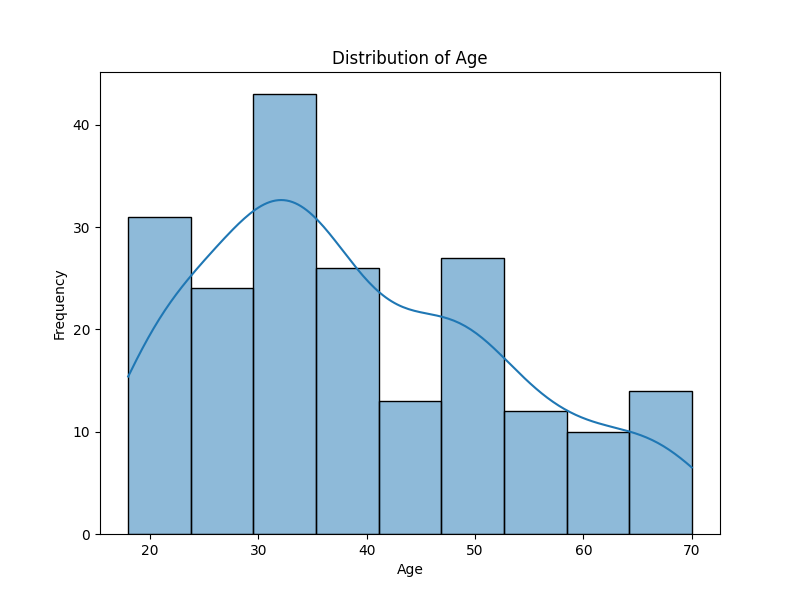
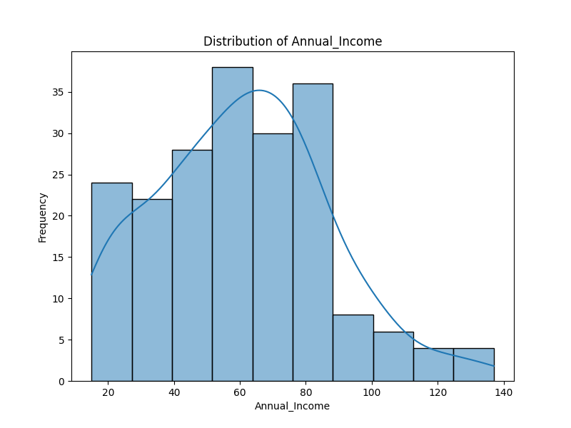
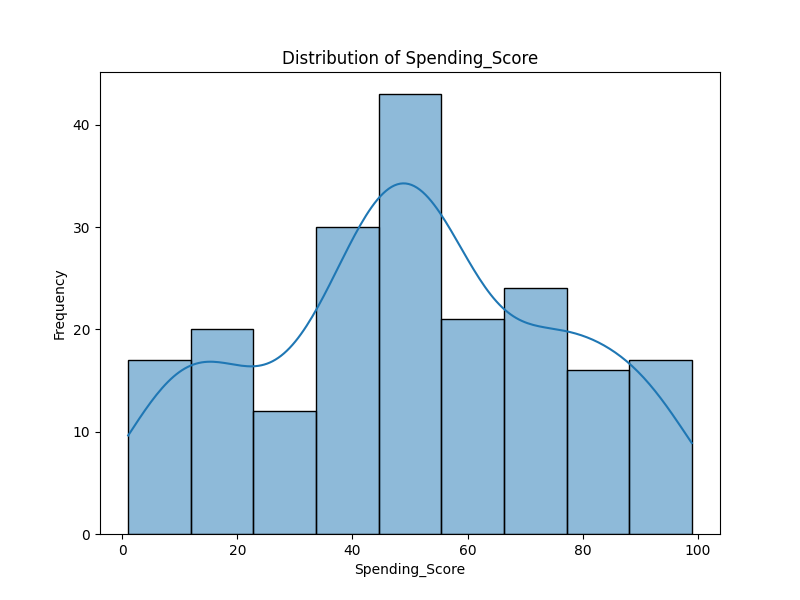
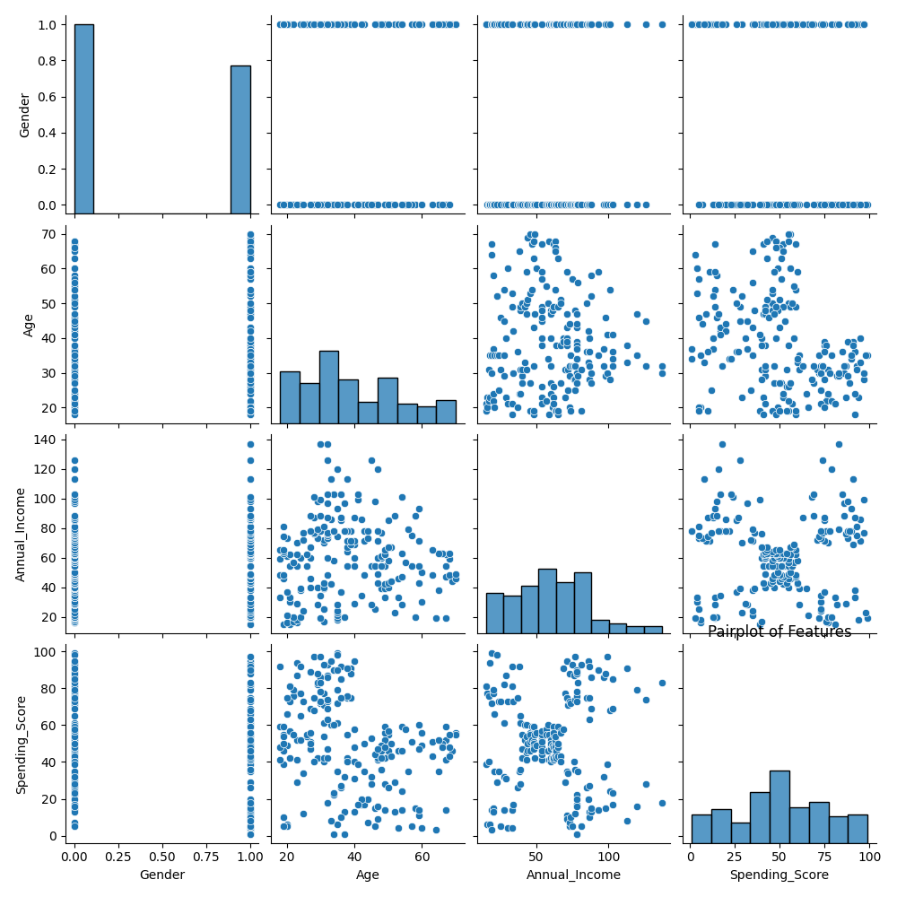
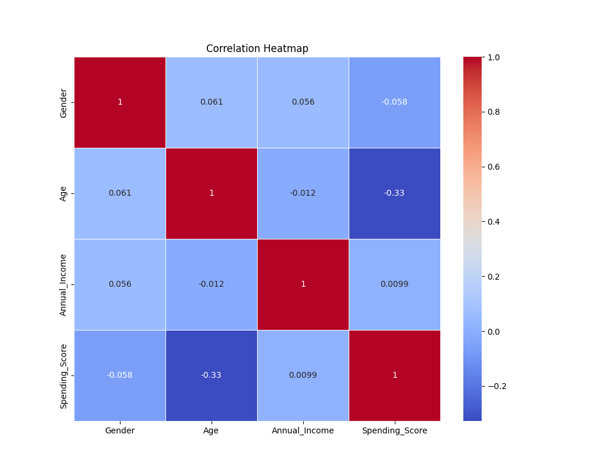
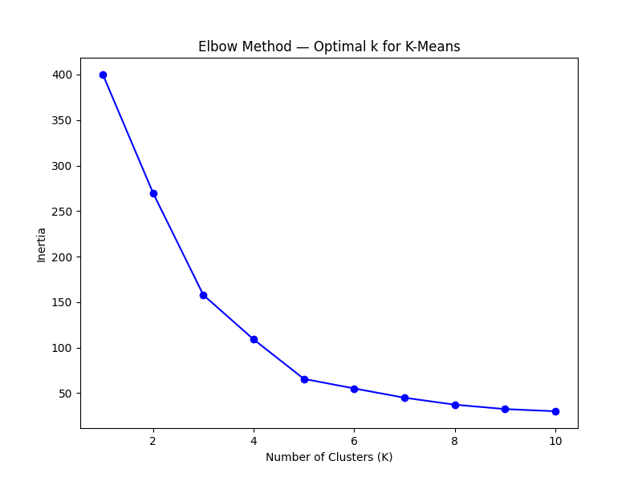
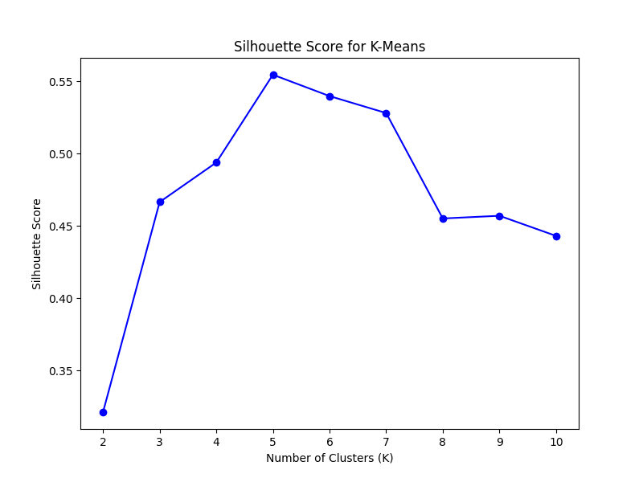
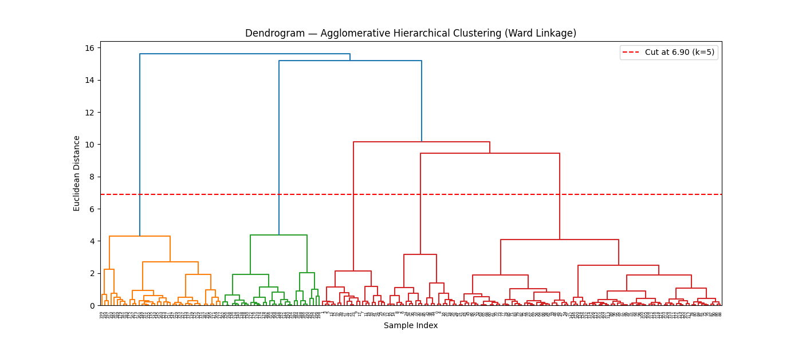
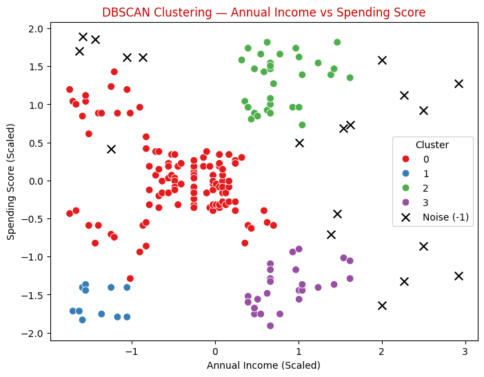
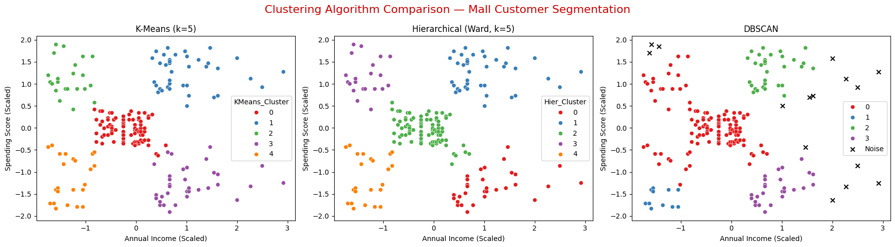

<div align="center">

# 🛍️ Mall Customer Segmentation

**An unsupervised-learning project that groups mall customers into meaningful segments using K-Means, Hierarchical (Ward) and DBSCAN clustering, then turns the clusters into practical marketing actions.**


</div>

---

## 📑 Table of Contents

1. [Project Overview](#-project-overview)
2. [Key Results](#-key-results)
3. [Video Walkthrough](#-video-walkthrough)
4. [Dataset](#-dataset)
5. [Project Structure](#-project-structure)
6. [Methodology](#-methodology)
7. [Exploratory Data Analysis](#-exploratory-data-analysis)
8. [Clustering Results](#-clustering-results)
9. [Business Insights](#-business-insights)
10. [Installation & Usage](#-installation--usage)
11. [Tech Stack](#-tech-stack)
12. [Limitations](#-limitations)
13. [Future Work](#-future-work)
14. [Author](#-author)

---

## 📌 Project Overview

A shopping mall wants to understand **who its customers are** so it can target promotions instead of treating everyone the same. There are no predefined labels, so this is an **unsupervised learning** problem: the algorithms must discover natural groups in the data.

This project:

- Explores the customer data (distributions, correlations, pairplot).
- Scales the features so that no single feature dominates the distance calculations.
- Finds the best number of clusters with the **Elbow method** and **Silhouette score**.
- Compares three algorithms: **K-Means**, **Agglomerative Hierarchical (Ward linkage)** and **DBSCAN**.
- Translates the clusters into **named customer segments** with a recommended marketing action for each.

---

## 🏆 Key Results

| | |
|---|---|
| **Optimal number of clusters** | **5** (Elbow and Silhouette agree) |
| **Best silhouette score** | 0.5547 (K-Means, k = 5) |
| **Recommended algorithm** | K-Means |
| **Segments found** | Mid/Mid, High/High, Low/High, High/Low, Low/Low (Income / Spend) |
| **Most valuable segment** | High Income, High Spend (39 customers) |
| **Biggest opportunity** | High Income, Low Spend (35 customers) |

---

## 🎥 Video Walkthrough

A recorded explanation of the project, covering the dataset, approach, clustering results and business insights.

🔗 **Link:** [Project Video Explanation](https://drive.google.com/file/d/1kKSes_GRVb5V1Tq1riPYI30RtkrdPB7U/view?usp=sharing)

---

## 📊 Dataset

- **File:** `Dataset/Mall_Customers.csv`
- **Size:** 200 customers × 5 columns
- **Missing values:** None

| Column | Description | Used for clustering |
|--------|-------------|:-------------------:|
| `CustomerID` | Unique customer identifier | ❌ Dropped |
| `Gender` | Male / Female (label-encoded) | ❌ Explored only |
| `Age` | Age in years (18 to 70, mean 38.9) | ❌ Profiling only |
| `Annual Income (k$)` | Annual income in thousand dollars (15 to 137, mean 60.6) | ✅ |
| `Spending Score (1-100)` | Score assigned by the mall based on spending behaviour (1 to 99, mean 50.2) | ✅ |

---

## 📁 Project Structure

```text
Unsupervised_Learning_PR/
├── Dataset/
│   └── Mall_Customers.csv              # Raw dataset
├── Screenshot/
│   ├── Age_histogram.png
│   ├── Annual_Income_histogram.png
│   ├── Spending_Score_histogram.png
│   ├── pairplot.png
│   ├── correlation_heatmap.png
│   ├── elbow_method.png
│   ├── silhouette_score.png
│   ├── dendrogram.png
│   ├── dbscan_clusters.png
│   └── three_panel_comparison.png
├── Unsupervised_Learning_PR.ipynb      # Full analysis (Tasks 1–6)
├── requirements.txt                    # Python dependencies
└── README.md
```

---

## 🔬 Methodology

The notebook is organised into six tasks:

| Task | Topic | Summary |
|:----:|-------|---------|
| **1** | Data Loading & EDA | Load data, check quality, histograms, pairplot, correlation heatmap |
| **2** | Scaling & Feature Selection | `StandardScaler` on numeric features; select Annual Income and Spending Score |
| **3** | K-Means | Elbow method, Silhouette score, final model with k = 5 |
| **4** | Hierarchical Clustering | Ward linkage, dendrogram, cut at k = 5 |
| **5** | DBSCAN | k-distance plot, `eps` / `min_samples` grid search, noise detection |
| **6** | Comparison & Insights | Side-by-side comparison, segment profiling, marketing recommendations |

### Preprocessing

1. Dropped `CustomerID` and renamed columns to `Annual_Income` and `Spending_Score`.
2. Label-encoded `Gender`.
3. Applied `StandardScaler` to `Age`, `Annual_Income` and `Spending_Score`. All three algorithms use Euclidean distance, so without scaling, income (range 15 to 137) would dominate the clustering.
4. Selected **Annual Income and Spending Score** as the clustering features. This is the only pair with visible structure in the pairplot, and it can be plotted directly in 2D without PCA.

---

## 🔍 Exploratory Data Analysis

### Feature Distributions

<table>
  <tr>
    <td align="center"><br/><em>Figure 1: Age</em></td>
    <td align="center"><br/><em>Figure 2: Annual Income</em></td>
    <td align="center"><br/><em>Figure 3: Spending Score</em></td>
  </tr>
</table>

- **Age** ranges from 18 to 70, with most customers in their 20s to 40s.
- **Annual Income** is right-skewed: a few high earners sit far above the mean.
- **Spending Score** is roughly bell-shaped around 50.

### Pairplot

<p align="center">
  
  <br/>
  <em>Figure 4: Pairplot of all features. Five compact groups are visible only in the Annual Income vs Spending Score panel.</em>
</p>

### Correlation Heatmap

<p align="center">
  
  <br/>
  <em>Figure 5: Correlation between features.</em>
</p>

Correlations are weak overall. The strongest is a mild negative one between **Age and Spending Score (-0.33)**, so no pair of features is redundant.

---

## 📈 Clustering Results

### 1. K-Means: Choosing k

<table>
  <tr>
    <td align="center"><br/><em>Figure 6: Elbow method</em></td>
    <td align="center"><br/><em>Figure 7: Silhouette score</em></td>
  </tr>
</table>

The Elbow curve bends at **k = 5**, and the Silhouette score peaks at **k = 5**, so both methods agree.

| k | 2 | 3 | 4 | **5** | 6 | 7 | 8 | 9 | 10 |
|---|:-:|:-:|:-:|:-----:|:-:|:-:|:-:|:-:|:--:|
| Silhouette | 0.321 | 0.467 | 0.494 | **0.555** | 0.540 | 0.528 | 0.455 | 0.457 | 0.443 |

### 2. Hierarchical Clustering

<p align="center">
  
  <br/>
  <em>Figure 8: Dendrogram with Ward linkage. The red dashed line cuts the tree into 5 clusters.</em>
</p>

Cutting through the longest stretch of the dendrogram with no merges gives **5 clusters**, matching the K-Means result. The cluster sizes are 85, 39, 32, 23 and 21 customers.

### 3. DBSCAN

<p align="center">
  
  <br/>
  <em>Figure 9: DBSCAN clusters. Black crosses mark noise points (label -1).</em>
</p>

A grid search over `eps` (0.2 to 0.6) and `min_samples` (3 to 6) was used. The final model uses **`eps = 0.4` and `min_samples = 5`**, which gives 4 clusters and 15 noise points.

- Too small an `eps` breaks real segments apart into noise (73 to 95 noise points at `eps = 0.2`).
- Too large an `eps` merges everything into 1 or 2 clusters (`eps ≥ 0.5`).

### 4. Algorithm Comparison

<p align="center">
  
  <br/>
  <em>Figure 10: K-Means vs Hierarchical vs DBSCAN on the same data.</em>
</p>

| Algorithm | Clusters | Silhouette | Notes |
|-----------|:--------:|:----------:|-------|
| **K-Means** | 5 | **0.5547** | Clear centroids, easy to explain, can assign new customers |
| Hierarchical (Ward) | 5 | 0.5538 | Nearly identical profiles to K-Means |
| DBSCAN | 4 | 0.4781 | Flags 15 outlier customers; noise excluded from the score |

K-Means and Hierarchical clustering produce almost the same segments, which gives confidence that the five groups are real structure and not an artefact of one algorithm.

---

## 💼 Business Insights

### Customer Segments (K-Means, k = 5)

| Segment | Customers | Share | Avg Age | Avg Income (k$) | Avg Spending Score |
|---------|:---------:|:-----:|:-------:|:---------------:|:------------------:|
| Mid Income, Mid Spend | 81 | 40.5% | 42.7 | 55.3 | 49.5 |
| **High Income, High Spend** | 39 | 19.5% | 32.7 | 86.5 | 82.1 |
| Low Income, High Spend | 22 | 11.0% | 25.3 | 25.7 | 79.4 |
| **High Income, Low Spend** | 35 | 17.5% | 41.1 | 88.2 | 17.1 |
| Low Income, Low Spend | 23 | 11.5% | 45.2 | 26.3 | 20.9 |

### Recommended Marketing Action per Segment

| Segment | Recommended Action | Why |
|---------|--------------------|-----|
| **High Income, High Spend** | VIP loyalty programme: early access to sales, exclusive events, personal shopping offers | Highest value segment; retention matters more than acquisition |
| **High Income, Low Spend** | Premium brand and lifestyle campaigns: luxury and dining brands, personalised invitations | The income is there; even a modest rise in spending gives the biggest revenue gain |
| **Low Income, High Spend** | Budget promotions: discount days, instalment offers, youth deals, points scheme | They already spend heavily relative to income; keep them loyal with value |
| **Mid Income, Mid Spend** | Tiered rewards scheme and seasonal offers | Largest group; a small uplift per customer adds up, and tiers encourage upgrades |
| **Low Income, Low Spend** | Low-cost, high-reach promotions: coupons, food-court and entertainment deals | Limited revenue potential, so keep campaign cost low |

### Recommended Algorithm for Deployment: **K-Means**

- **Interpretability:** each centroid maps directly to a named business segment.
- **New customers:** a new customer is assigned to a segment by finding the nearest centroid.
- **Stability:** Income vs Spending Score forms compact, well-separated groups, which suits K-Means best.

**When to choose the alternatives:** use **DBSCAN** when outliers must be flagged explicitly, and **Hierarchical clustering** when management wants a dendrogram to decide between broad and detailed groupings.

---

## ⚙️ Installation & Usage

### Prerequisites

- Python 3.9 or higher
- `pip`

### 1. Clone the repository

```bash
git clone https://github.com/HarshalVora86/Unsupervised_Learning_PR.git
cd Unsupervised_Learning_PR
```

### 2. Create a virtual environment (recommended)

```bash
python -m venv venv

# Windows
venv\Scripts\activate

# macOS / Linux
source venv/bin/activate
```

### 3. Install dependencies

```bash
pip install -r requirements.txt
```

### 4. Run the notebook

```bash
jupyter notebook Unsupervised_Learning_PR.ipynb
```

> The notebook reads the data from `Dataset/Mall_Customers.csv`, so run it from the project root folder.

---

## 🛠 Tech Stack

| Purpose | Tools |
|---------|-------|
| Language | Python |
| Data handling | NumPy, Pandas |
| Clustering & preprocessing | scikit-learn (KMeans, AgglomerativeClustering, DBSCAN, StandardScaler, LabelEncoder) |
| Hierarchical analysis | SciPy (`linkage`, `dendrogram`) |
| Visualisation | Matplotlib, Seaborn |
| Environment | Jupyter Notebook |

---

## 👤 Author

**Harshal Vora**
Unsupervised Learning, Project PR1

- GitHub: [@HarshalVora86](https://github.com/HarshalVora86)
- LinkedIn: [Harshal Vora](https://www.linkedin.com/in/harshal-vora-344601251/)

---

